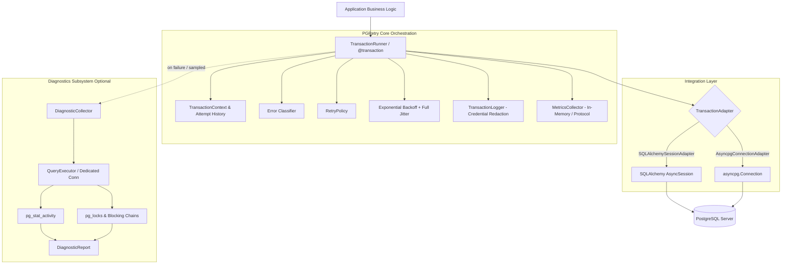
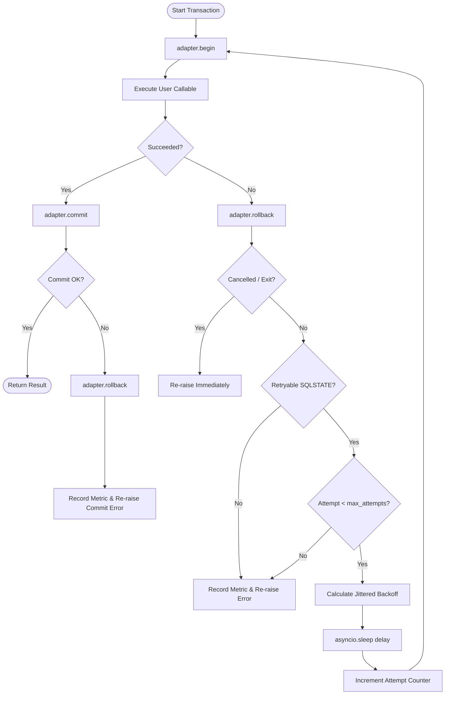

# How PGRetry Works

## What PGRetry Is (and Is Not)

### What PGRetry Is

* **A whole-transaction retry orchestrator:** Ensures that when a retryable PostgreSQL concurrency error occurs, the failed transaction is cleanly rolled back, delayed with randomized backoff, and the entire business logic callable is re-executed from the very beginning.
* **A SQLSTATE classification engine:** Distinguishes transient concurrency aborts (`40001`, `40P01`) from permanent data and constraint errors (`23505`, `23503`, `42P01`).
* **An observability engine for PostgreSQL concurrency:** Inspects PostgreSQL runtime state (`pg_stat_activity`, `pg_locks`, lock blocking graphs) when transactions fail or on demand.
* **A zero-dependency core library:** The core retry and transaction engine requires only Python 3.13+ standard library components (`asyncio`, `contextvars`, `dataclasses`).

### What PGRetry Is NOT

* **Not an ORM or Query Builder:** PGRetry does not map tables to Python classes, generate SQL, or manage database schemas. You continue using SQLAlchemy, SQLModel, Tortoise, or raw SQL.
* **Not a database driver:** PGRetry does not replace `asyncpg`, `psycopg`, or `psycopg2`. It wraps driver connections and sessions.
* **Not an automatic isolation level modifier:** PGRetry does not alter your PostgreSQL connection's transaction isolation level. If your workload requires `SERIALIZABLE` or `REPEATABLE READ`, your application or connection pool must configure it explicitly.
* **Not a distributed lock manager:** PGRetry does not use Redis, ZooKeeper, or etcd. It relies strictly on PostgreSQL's native MVCC and locking primitives.

---

---

## The Core Problem: Why Whole-Transaction Retries Are Required

PostgreSQL guarantees ACID transactions through Multi-Version Concurrency Control (MVCC) and lock managers. Under higher isolation levels or concurrent writes, conflicts are resolved by aborting one of the competing transactions:

* **`40001` — `serialization_failure`:** In `SERIALIZABLE` (or `REPEATABLE READ`), PostgreSQL detects that concurrent read/write sets could lead to an inconsistent state (a read-write anti-dependency cycle). PostgreSQL aborts the transaction with: `could not serialize access due to read/write dependencies among transactions`.
* **`40P01` — `deadlock_detected`:** Two or more concurrent transactions hold locks that the other requires, forming a cycle in the lock wait graph. PostgreSQL's deadlock detector fires and aborts one transaction to resolve the cycle.

### Conceptual Timeline of a Serialization Failure

```text
Time    Transaction A (Client 1)              Transaction B (Client 2)
 ───    ────────────────────────              ────────────────────────
 T1     BEGIN TRANSACTION ISOLATION LEVEL SERIALIZABLE;
 T2                                           BEGIN TRANSACTION ISOLATION LEVEL SERIALIZABLE;
 T3     SELECT balance FROM accounts          
        WHERE id = 1; (reads 100)             
 T4                                           SELECT balance FROM accounts 
                                              WHERE id = 1; (reads 100)
 T5     UPDATE accounts SET balance = 70      
        WHERE id = 1;                         
 T6                                           UPDATE accounts SET balance = 60 
                                              WHERE id = 1;
 T7     COMMIT; (Succeeds)                    
 T8                                           COMMIT;
                                                │
                                                └── PostgreSQL detects SSI conflict!
                                                    Aborts Transaction B:
                                                    ERROR: 40001 serialization_failure
```

### Why Retrying a Single Statement Fails

A common anti-pattern is attempting to catch the database exception around a single SQL query:

```python
# ❌ WRONG: Attempting to retry only the failed query
async def update_balance(session, account_id, amount):
    balance = await session.fetch_balance(account_id)  # Read on attempt 1
    new_balance = balance - amount
    try:
        await session.execute_update(account_id, new_balance)
    except ConcurrencyError:
        # Fails! Transaction is already in an ABORT state in PostgreSQL.
        # Furthermore, 'balance' was read before the conflict and is now stale!
        await session.execute_update(account_id, new_balance)
```

In PostgreSQL:
1. Once any error occurs inside a transaction block, PostgreSQL places the entire transaction into an **aborted state**. Every subsequent query on that connection—including a retried query—fails with `current transaction is aborted, commands ignored until end of transaction block` until an explicit `ROLLBACK` is issued.
2. Even if PostgreSQL permitted statement retries, the snapshot read at `T4` was stale. Retrying only the `UPDATE` statement would overwrite Transaction A's committed changes, corrupting account balances.

### The Correct Response: Whole-Transaction Replay

```text
Transaction Fails (40001 / 40P01)
       │
       ▼
   ROLLBACK  (Resets connection state in PostgreSQL)
       │
       ▼
Backoff + Full Jitter  (Relieves database contention)
       │
       ▼
Re-execute ENTIRE Callable from the beginning
(Reads fresh snapshot -> executes business logic -> writes updates)
       │
       ▼
     COMMIT
```

---

---

## Architecture

PGRetry is built as a set of decoupled, single-responsibility modules:



### Subsystem Overview

| Subsystem | Modules | Core Responsibility |
| :--- | :--- | :--- |
| **`pgretry.retry`** | `policy.py`, `backoff.py`, `classifier.py` | Immutable retry policies, full-jitter exponential backoff math, and SQLSTATE-aware error classification. |
| **`pgretry.transaction`** | `runner.py`, `context.py`, `decorator.py` | Whole-transaction execution lifecycle, `ContextVar`-based runtime attempt tracking, and declarative decorators. |
| **`pgretry.postgres`** | `errors.py`, `activity.py`, `locks.py`, `diagnostics.py` | Driver-agnostic PostgreSQL error normalization, session inspection (`pg_stat_activity`), lock analysis (`pg_locks`), and `DiagnosticReport` synthesis. |
| **`pgretry.instrumentation`** | `logging.py`, `metrics.py` | Structured event logging with automatic password/URL redaction, and thread-safe metrics collection. |
| **`pgretry.integrations`** | `sqlalchemy.py`, `asyncpg.py` | Concrete `TransactionAdapter` implementations for SQLAlchemy `AsyncSession` and `asyncpg.Connection`. |

---

---

## Transaction-Level Retry Orchestration

The `TransactionRunner` is the central orchestrator in PGRetry. It guarantees the following lifecycle invariants:

1. **Explicit Transaction Boundary:** Calls `adapter.begin()` before each execution attempt.
2. **Whole Callable Execution:** Calls `await operation(*args, **kwargs)` from the very first line of code on every attempt.
3. **Clean Commit:** If the callable returns without error, calls `adapter.commit()`.
4. **Immediate Rollback on Any Exception:** If an exception occurs during operation execution or commit, `adapter.rollback()` is executed immediately. If `commit()` raises, the error is immediately surfaced to the caller and NEVER retried due to ambiguous commit outcome. Rollback errors never mask the primary operational failure.
5. **Immediate Cancellation Propagation:** If an `asyncio.CancelledError`, `KeyboardInterrupt`, or `SystemExit` occurs, the transaction is rolled back and the signal is re-raised immediately without retrying.
6. **SQLSTATE Classification:** The exception is inspected and classified against standard PostgreSQL error codes.
7. **Backoff Pacing strictly AFTER Rollback:** Delay occurs strictly *after* the failed transaction has been rolled back in PostgreSQL, freeing held locks before sleeping.
8. **Bounded Attempts:** If the maximum attempts configured in `RetryPolicy` are reached, the original exception is re-raised.



### Why Python Context Managers Cannot Retry Blocks

Developers frequently ask why PGRetry uses callables and decorators rather than an `async with` context manager:

```python
# ❌ IMPOSSIBLE IN STANDARD PYTHON:
async with pgretry.transaction():
    await do_work_1()
    await do_work_2()  # If this raises 40001...
```

Under Python's PEP 343 and PEP 492 specifications, context managers execute their enclosed body **exactly once**. A context manager's `__aexit__` method can catch an exception and suppress it, but **it cannot jump the instruction pointer back to the start of the `async with` block**. 

To replay the sequence from the beginning, the operations must be encapsulated in an async callable passed to `TransactionRunner.run()` or decorated with `@transaction`.

---
